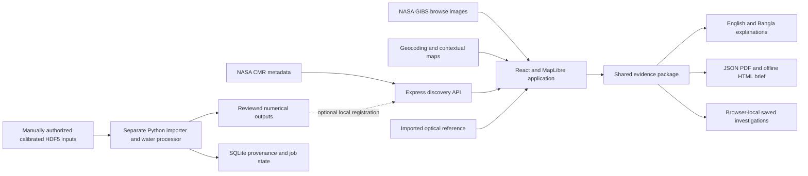

# Science, architecture and reproduction

## The evidence boundary

This snapshot contains real NASA NISAR browse imagery and real observation metadata. Its quantitative educational examples are synthetic. The local importer and water workflow have software tests, but no actual calibrated NISAR measurement series has completed the end-to-end analysis and independent evaluation in this checkout. There is no measured flood accuracy, independently established event confidence, or confirmed inundated area to report.

Source product maturity and software test success are different from scientific validation. NISAR provisional products also have their own [documented known issues](https://nisar-docs.asf.alaska.edu/provisional-known-issues/).

## Architecture



The web deployment is React/Vite plus an Express serverless entry point. The Python processor is separate and requires persistent storage and compatible inputs. A single worker owns its SQLite volume; this is durable local job state, not a distributed global processing queue. Browser-local storage is not cloud synchronization.

## Numerical teaching method

The teaching engine accepts positive linear-power values or missing cells, applies a common valid-data mask, and computes:

`change_dB = 10 * log10(after_linear_power / before_linear_power)`

An optional 3 × 3 linear-power box mean is available in the teaching analysis. It preserves invalid centers. A user-selected absolute-change threshold identifies candidate changed cells. Outputs include common valid counts, signed changes, distributions and threshold sensitivity. Hotspots use four-connected native-grid cells of the same sign.

These illustrative examples are not geolocated flood polygons or calibrated disaster measurements. Threshold sensitivity is not a probability. Intensity change is not displacement, cause attribution or confirmed damage. These exercises do not implement interferometric displacement estimation.

## Calibrated GCOV import

`scripts/import_gcov.py` and `scripts/gcov_reader.py` accept a bounded native window from compatible local products. Checks cover supported specification, RTC linear gamma-zero radiometry, projected regular north-up metric grid, compatible geometry/track/frame/look/pass, polarization channels, valid positive measurements, quality support and source identity. Source files are hashed. A check-only mode does not register a dataset.

Supported windows are 3–256 pixels for the numerical importer, with 2–30 local products. A quality-review acknowledgement is an operator declaration, not independent proof that the calibration is valid. Catalogue overlap and matching timestamps do not establish valid measurement support at an exact point.

## Experimental water workflow

The separate water workflow uses at least three earlier compatible observations and one target, aligned native grids, co- and cross-polarized measurements and a documented aligned terrain mask. It distinguishes persistent water, candidate new water, receding water, non-water, insufficient evidence and excluded pixels. It uses a median baseline and configurable dB thresholds. Initial defaults include co-polarized −17 dB, cross-polarized −24 dB, change 3 dB and margin 1 dB.

These are experimental parameters, not universal or independently calibrated thresholds. The water workflow has no speckle filtering or adaptive regional threshold calibration. Missing terrain or cross-polarization support must not silently become clear evidence. Area is only meaningful when grid geometry and valid classification support it. Unknown and excluded pixels must remain identifiable.

The imported Rasuwa EMSR927 reference concerns optical mass-movement interpretation, not binary water classification. It cannot be used to claim flood precision, recall or intersection-over-union. Evaluation code exists, but no real reference evaluation has established these metrics for SARFlow.

## How to establish the first real result

1. Choose one question and area with suitable compatible calibrated observations and a defensible reference.
2. Obtain authorized products and retain original acquisition IDs, source links and SHA-256 hashes.
3. Check radiometry, product version, geometry, polarization, valid support and date compatibility before comparing.
4. Document masks and terrain support; separate missing pixels from unchanged ones.
5. Run the existing importer in check-only mode first; then generate a new registered dataset without replacing an existing one.
6. Record parameters, grid bounds, CRS, valid pixel count, processing time and method version.
7. Evaluate against an appropriate independently sourced reference with its timing, method and uncertainty disclosed. Report false positives, false negatives and excluded support, not only a favorable headline number.
8. Publish a reproducible evidence bundle only after review. Use "processed candidate" until the interpretation is independently supported.

No result from this procedure has been invented for this submission package.

## Source map

| Area | Main files |
| --- | --- |
| Global interface | `src/pages/World.tsx`, `GlobalRadar.tsx`, `Observatory.tsx`; `src/components/ObservationMap.tsx` |
| Place ledger | `src/components/PlaceObservatory.tsx`, `server/place-observatory.ts`, `shared/place-observatory.ts` |
| Catalogue and refresh | `server/catalog.ts`, `global-radar.ts`, `coverage.ts`, `src/data/useRadarUpdates.ts` |
| API and policy | `server/app.ts`, `http-policy.ts`, `job-retention.ts`, `api/index.ts` |
| Numerical methods | `shared/analysis.ts`, `hotspots.ts`, `scripts/gcov_reader.py`, `water_algorithm.py`, `water_pipeline.py` |
| Evidence and assistant | `shared/evidence-package.ts`, `evidence-answers.ts`, `src/components/InvestigationTools.tsx` |
| Exports and persistence | `src/components/exportReport.ts`, `shared/evidence-report.ts`, `saved-investigations.ts` |
| Independent reference | `shared/external-reference.ts`, `src/components/ExternalReferencePanel.tsx`, `public/data/references/` |
| Durable local processor | `processor/store.py`, `service.py`, `ingest.py`, `worker.py`, `validation.py` |
| Provenance | `DATA_PROVENANCE.md`, `SCIENTIFIC_NOTES.md`, `public/data/observatory.json` |
| Checks | `tests/`, `.github/workflows/`, `eslint.config.js` |

## Run the web application

Use a supported Node.js installation; CI config currently uses Node 24. From the extracted repository root:

```powershell
npm ci
npm run dev
```

Open `http://127.0.0.1:5186`. Vite proxies `/api` to the local Express server on port 5187. Port availability and upstream connectivity are required.

For a built local application:

```powershell
npm run build
npm start
```

Open `http://127.0.0.1:5187`. `npm run preview` alone is not the full Express/API launch. The ZIP excludes dependencies, environments and credentials; install dependencies locally. It also excludes local data and outputs, so it does not carry an actual calibrated measurement series.

## Run software checks

```powershell
npm run lint
npm run format:check
npm run check
python -m venv .venv-water
.\.venv-water\Scripts\python.exe -m pip install -r processor/requirements.txt -r scripts/image-requirements.txt
.\.venv-water\Scripts\python.exe -m unittest discover -s tests -p 'test_*.py'
```

For browser checks, install Playwright's browser dependency as needed, keep `npm run dev` running, and run `npm run test:e2e`. Network-dependent checks and platform-specific paths may require environment setup. Follow `WATER_WORKFLOW.md` and `docs/automatic-monitoring.md` for the optional Python workflow. A safe metadata-only worker cycle is:

```powershell
.\.venv-water\Scripts\python.exe -m processor.service --once
.\.venv-water\Scripts\python.exe -m processor.cli status
```

This checks metadata; it does not download calibrated inputs or prove measurement accuracy. Authentication, when required for optional ingestion, must be performed manually through the interactive non-persisted flow. Never include credentials in a source submission.

## Verification record and boundaries

Previous October 20 implementation records report 91 JavaScript tests, 44 Python tests, successful lint/format/build, focused browser regressions and a Vercel Ready build. Browser runs overlap and must not be summed as distinct test cases. See `docs/implementation/2026-10-20-source-readability.md` and related implementation records for the original commands and scope.

Those are software verification results, not measured scientific accuracy. Package integrity verification is recorded separately alongside the ZIP. No new real-data analysis, field validation, production deployment or full cross-platform reproduction was performed merely by assembling these documents.

## Licensing and responsible reuse

No project-level software LICENSE was found. The owner must choose one appropriate to ownership and the event's actual requirements; this package does not grant a license on their behalf. Dependencies and data have separate terms. Preserve NASA/JPL-Caltech/ASF, EOX/Copernicus, OSM, Open-Meteo/GeoNames, EMS/UNESCO, Natural Earth and font credits. Do not imply NASA endorsement or label Sentinel-2 as NISAR.
